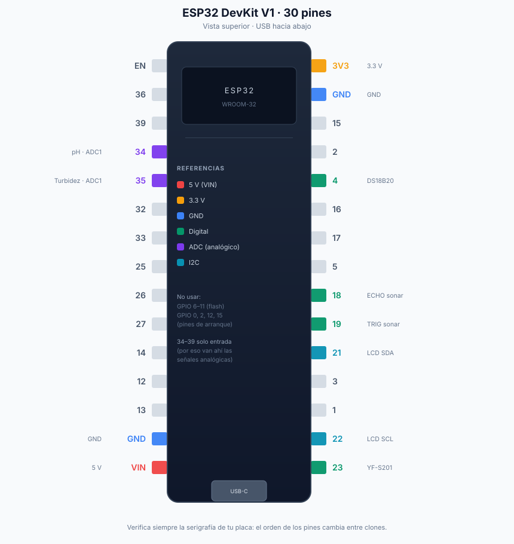

# Cableado y conexiones



## 1. Mapa de pines (ESP32 DevKit V1, 30 pines)

```
                    ┌──────────────────────┐
       EN           │                      │ 3V3 ── DS18B20 VDD, pull-ups
  36 (VP)           │                      │ GND
  39 (VN)           │      ESP32           │ 15
  34 ── pH (ADC1)   │      DevKit V1       │ 2
  35 ── Turb (ADC1) │       30 pin         │ 4  ── DS18B20 DATA (OneWire)
  32                │                      │ 16
  33                │                      │ 17
  25                │                      │ 5
  26 ── Caudal SALIDA│                      │ 18 ── HC-SR04 ECHO (4.7k en serie)
  27                │                      │ 19 ── HC-SR04 TRIG
  14                │                      │ 21 ── LCD SDA
  12                │                      │ 3
  13                │                      │ 1
  GND               │                      │ 22 ── LCD SCL
  VIN (5V USB)      │                      │ 23 ── Caudal ENTRADA
                    └──────────────────────┘
```

| Función | GPIO | Notas |
| --- | --- | --- |
| HC-SR04 TRIG | 19 | Salida 3.3 V, el sensor acepta 3.3 V en TRIG |
| HC-SR04 ECHO | 18 | Resistencia de 4.7 kΩ **en serie** (ECHO → 4.7k → D18). Con este clon un divisor a GND deja de leer |
| Caudal **entrada** (amarillo) | 23 | Amarillo → 4.7 kΩ en serie → D23. Pull-up interno del ESP32 |
| Caudal **salida** (amarillo) | 26 | Amarillo → 4.7 kΩ en serie → D26. Pull-up interno del ESP32 |
| DS18B20 DATA | 4 | Pull-up 4.7 kΩ a **3.3 V** |
| pH (Po) | 34 | ADC1, solo entrada. **Máx 3.3 V** |
| Turbidez (A) | 35 | ADC1, solo entrada. **Máx 3.3 V** |
| LCD SDA | 21 | I2C |
| LCD SCL | 22 | I2C |

> No uses GPIO 6–11 (flash interna), ni 0/2/12/15 para cosas que deban arrancar siempre
> igual (son pines de *strapping*). Los elegidos evitan todos esos casos.

## 2. Alimentación

| Módulo | Voltaje | Consumo aprox. |
| --- | --- | --- |
| HC-SR04 | 5 V | 15 mA |
| ZJ-S201 / YF-S201 (×2) | 5–24 V (5 V sirve) | 15 mA c/u |
| DS18B20 | 3.0–5.5 V | 1.5 mA |
| Módulo pH | 5 V (ver nota) | 10 mA |
| TS-300B turbidez | 5 V | 40 mA (máx) |
| LCD 1602 + I2C | 5 V | 20 mA + backlight |

- Todos los **GND en común** con el ESP32.
- Para pruebas, el USB alcanza (~100 mA). Para la instalación final usa fuente de 5 V / 2 A.
- **Nunca** alimentes el HC-SR04 con 3.3 V: mide mal.

## 3. Divisores de tensión (con las resistencias de 4.7 kΩ)

### HC-SR04 ECHO (5 V → 3.3 V)

```
ECHO ──[ 4.7k ]──┬── GPIO18
                 │
              [ 4.7k ]
                 │
                GND
```

Salida ≈ 2.5 V. El ESP32 lo lee como HIGH (el umbral es ~0.75 × 3.3 V = 2.47 V), pero queda
**al límite**. Si tienes 1 kΩ y 2 kΩ, usa esa pareja (5 V → 3.33 V, más margen). Si ves
lecturas inestables, cambia a `1k + 2k` o `4.7k + 10k`.

### Turbidez TS-300B (hasta 4.5 V → 3.3 V)

```
AO ──[ 4.7k ]──┬── GPIO35
               │
            [ 4.7k ]
               │
              GND
```

Salida ≈ mitad de la original: 4.5 V → 2.25 V. En el firmware se compensa con
`TURBIDITY_DIVIDER = 2.0` (el voltaje real es el doble del medido). Con un divisor
`4.7k + 10k` se aprovecha mejor el rango del ADC (4.5 V → 3.06 V), pero entonces hay que
ajustar el factor a `(4.7+10)/10 = 1.47`.

### pH PH-7BNC

El módulo entrega entre 0 y ~3.8 V según el pH (≈2.5 V en pH 7). Alimentado a 5 V hay que
**dividir la salida** para no pasar de 3.3 V:

- **Recomendado:** VCC a 5 V y divisor `4.7k + 4.7k` en la salida `Po` → el firmware usa
  `PH_DIVIDER = 2.0` (valor por defecto).
- Alternativa sin divisor: alimentar el módulo a **3.3 V**. La señal queda dentro de rango,
  pero hay que cambiar `PH_DIVIDER` a `1.0f` en `config.h` y recalibrar. No todos los
  módulos funcionan bien a 3.3 V.

> El electrodo de pH no debe quedarse seco. Guárdalo en la solución de almacenamiento
> (KCl 3 M) y no lo dejes sumergido en agua corriente por semanas: se degrada.

## 4. Sensores, uno por uno

### HC-SR04 — nivel

- Montaje: en la **tapa**, mirando hacia abajo, perpendicular al agua.
- Rango útil 2–400 cm; con el tanque lleno el eco debe volver sin obstáculos.
- `nivel = altura_tanque − distancia_medida − offset_sensor`.
- Calibra la altura real del tanque en el panel de ajustes del dashboard.
- Ojo con la condensación: el sensor no es sumergible. Usa un tubo guía o montura
  elevada y sella la electrónica.

### ZJ-S201 / YF-S201 — caudal de entrada y de salida

- Hay dos: **entrada** en D23 y **salida** en D26. La web los muestra en dos tarjetas
  (y el "Neto" = entrada − salida); la LCD, en la página "Entra / Sale".
- Cables: **rojo → VIN (5 V)**, **negro → GND**, **amarillo → resistencia 4.7 kΩ → D23 / D26**.
- La salida del sensor puede llegar a 5 V: la resistencia en serie limita la corriente
  (< 0.3 mA) y el ESP32 usa su pull-up interno. **No** pongas un pull-up externo a 3.3 V
  junto con la resistencia en serie: el nivel bajo quedaría en ~1.6 V y no contaría pulsos.
- Instálalo respetando la **flecha** del cuerpo (sentido del agua).
- F = 7.5 × Q (L/min) → **450 pulsos = 1 litro** (`DEFAULT_FLOW_PPL`). Rango 1–30 L/min:
  por debajo de ~1 L/min la turbina no gira.
- El firmware ignora flancos a menos de 1 ms (ruido) y guarda cada acumulado en la memoria
  cada 30 s si cambió. "Reiniciar acumulados de caudal" en la web pone ambos en 0.
- Sin agua circulando no hay pulsos: el indicador queda gris (no se puede saber si está
  conectado) y pasa a verde mientras mide caudal.

### DS18B20 — temperatura

- Sonda impermeable, la mayoría vienen en cable de 3 hilos (rojo VDD, negro GND, amarillo DATA).
- Pull-up 4.7 kΩ entre DATA y 3.3 V.
- Resolución 12 bits (0.0625 °C). El firmware hace la conversión de forma no bloqueante.

### PH-7BNC — pH

- Sonda BNC + módulo con potenciómetros de offset y pendiente.
- Deja los potenciómetros en posición media al principio y calibra por software
  (ver [`calibracion.md`](calibracion.md)).
- Necesita estar siempre húmedo; enjuaga con agua destilada entre mediciones.
- La lectura se filtra con mediana de 15 muestras para quitar ruido del ADC.

### TS-300B — turbidez

- Sensor óptico: la suciedad en el lente falsea la lectura. Límpialo cada tanto.
- No lo sumerjas más allá de la marca; la electrónica va fuera del agua.
- Módulo de 4 pines (`V`, `D`, `G`, `A`); la sonda va al conector numerado `4 3 2 1`.
- Salida según el fabricante: agua clara 4.1–4.5 V. **Medido con este módulo:** agua de caño
  2.89 V y agua con tierra 2.52–2.63 V (ver `docs/calibracion.md`).
- Conversión NTU usada (aproximada, para tendencias más que para laboratorio):
  `NTU = −1120.4·Ve² + 5742.3·Ve − 4352.9`, con `Ve = V × 4.2 / turbClearV` y V ya
  compensado por el divisor.
- El dashboard además muestra **% de claridad** referido al voltaje de agua clara calibrado.

### LCD 1602 I2C

- Dirección típica `0x27` (algunos `0x3F`). El firmware la detecta solo al arrancar y la
  informa por el monitor serie (`[lcd] pantalla en 0x27`).
- Alimenta a 5 V; SDA/SCL al ESP32 (3.3 V) funciona porque el backpack tiene pull-ups
  propios. Si el bus falla, prueba subir con 4.7 kΩ a 3.3 V.

## 5. Armado sugerido con el cable flat

1. Corta el flat en dos tramos: uno para señales analógicas (pH, turbidez) y otro para
   digitales (ultrasónico, flujo, OneWire, I2C).
2. Usa los hilos de los extremos como **GND** y **5 V**, y deja uno libre entre señal y
   alimentación para reducir acoplamiento.
3. Suelda o usa borneras; el flat dupont se afloja con la vibración.
4. Etiqueta cada hilo en ambos extremos (PH, TURB, TRIG, ECHO, FLOW, TEMP, SDA, SCL).
