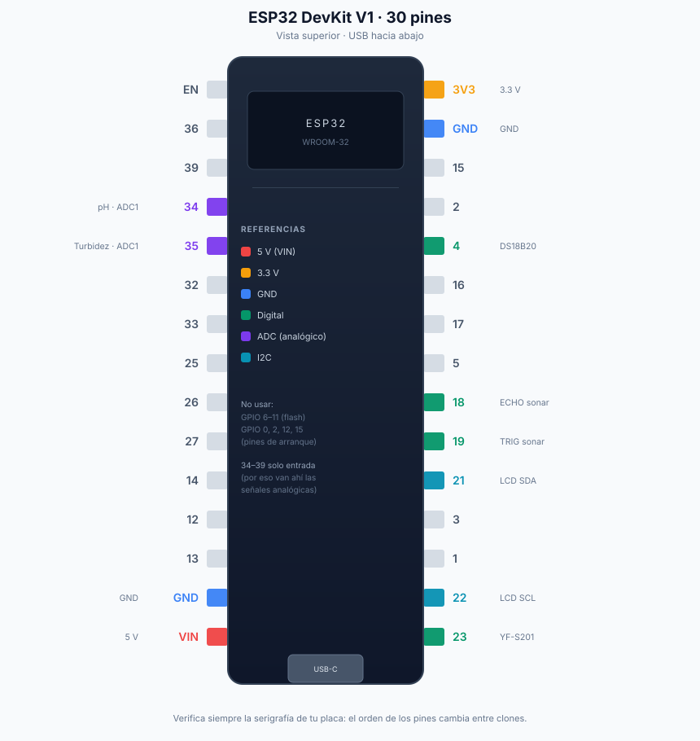

# Guía de inicio: de cero al primer dato (sin soldar)

Esta guía asume que **todavía no conectaste nada**. Vamos en este orden: preparar la PC,
probar la placa sola, ver el dashboard, armar la protoboard y agregar **un sensor a la vez**,
probando cada uno antes de pasar al siguiente. Al final, la lista para recién entonces soldar.

Tiempo estimado: 2–3 h la primera vez (sin contar la descarga de herramientas).

---

## 0. Mapa del camino

| Etapa | Qué haces | Resultado |
| --- | --- | --- |
| A | Instalar herramientas y reconocer la placa | La PC "ve" el ESP32 |
| B | Subir el firmware sin sensores | El ESP32 arranca y muestra su IP |
| C | Abrir el dashboard en la PC | Ves las tarjetas con datos simulados |
| D | Armar la protoboard y conectar 1 sensor | Un dato real en pantalla |
| E | Repetir con los otros 4 sensores | Los 5 datos reales |
| F | Cargar la web al ESP32 | Dashboard desde el celular, sin PC |
| G | Calibrar y probar con agua | Medidas confiables |
| H | Checklist y soldadura | Montaje definitivo |

No saltes de la A a la D. Si algo falla, vas a saber exactamente qué cambió.

---

## 1. Materiales

### 1.1 Lo que ya tienes

| Componente | Para qué |
| --- | --- |
| ESP32 DevKit V1 30 pines (USB-C) | Cerebro + WiFi |
| HC-SR04 | Nivel de agua |
| YF-S201 | Caudal |
| DS18B20 (sonda) | Temperatura |
| Módulo pH PH-7BNC + sonda BNC | pH |
| TS-300B (SEN0189 compatible) | Turbidez |
| LCD 1602 con backpack I2C | Pantalla local |
| 20 resistencias 4.7 kΩ | Pull-up y divisores |
| Cable flat 40 pines | Cableado (para la versión soldada) |

### 1.2 Lo que **falta comprar** para probar sin soldar

| Material | Cantidad | Por qué |
| --- | --- | --- |
| **Protoboard (breadboard) de 830 puntos** | 1 | Es donde vas a armar todo sin soldar |
| **Cables dupont macho-macho** | ~30 | De la placa a la protoboard |
| **Cables dupont hembra-macho** | ~15 | Para módulos con pines macho (LCD, sensores) |
| **Cable USB-C de datos** | 1 | Muchos cables solo cargan; el de datos debe permitir transmisión |
| Multímetro | 1 (opcional pero muy recomendado) | Verificar 5 V / 3.3 V antes de conectar |
| Sobres de buffer pH 4.00 y 7.00 | 2 | Sin buffers el pH queda "aproximado" |
| Solución de almacenamiento KCl | 1 | El electrodo de pH no puede secarse |

> El cable flat de 40 pines es para el montaje final soldado. Para la protoboard usa dupont:
> el flat no entra en el breadboard.

### 1.3 Opcional para después

- Fuente de 5 V / 2 A con bornera (para dejar el sistema fijo).
- Caja IP65, prensaestopas, borneras de 2 y 3 vías.
- Sonda de nivel o flotador como respaldo (no incluido).

---

## 2. Cinco reglas de oro (léelas antes de conectar)

1. **El ESP32 vive en 3.3 V.** Ningún GPIO puede recibir 5 V. Ni analógico ni digital.
2. **Los módulos de 5 V van al pin `VIN`/`5V`**, nunca al pin `3V3`.
3. **Todo comparte GND.** La tierra del ESP32, de los sensores y de la fuente debe ser la misma.
4. **Desconecta el USB antes de mover cables.** Conecta, revisa, y recién ahí alimenta.
5. **Antes de energizar, revisa dos veces.** Especialmente que 5 V no haya caído en un GPIO.

La señal del YF-S201 y del DS18B20 **no** son de 5 V: son de colector abierto / drenador
abierto. Se alimentan a 5 V pero su señal se "tira" a GND, así que con una resistencia de
4.7 kΩ hacia 3.3 V quedan seguras para el ESP32. Los que sí entregan 5 V "de verdad" son
HC-SR04 (ECHO), turbidez (AO) y pH (Po): esos **necesitan divisor**.

---

## 3. Conocer la placa



Tu placa es la DevKit V1 de **30 pines**. Vista desde arriba, con el USB hacia abajo:

> **Ojo con la serigrafía:** muchas placas imprimen `D4`, `D15`, `D18`… en lugar de
> `GPIO4`, `GPIO15`, `GPIO18`. **Es el mismo pin**: `D4 = GPIO4`, `D19 = GPIO19`, etc.
> Los pines de alimentación dicen `3V3`, `VIN`/`5V` y `GND`.

```
        lado izquierdo                 lado derecho
        ─────────────                  ────────────
        EN                            3V3   ← 3.3 V (DS18B20, pull-ups)
 GPIO36 VP                            GND
 GPIO39 VN                            GPIO15
 GPIO34  ← pH (ADC1)                  GPIO2
 GPIO35  ← turbidez (ADC1)            GPIO4   ← DS18B20 DATA
 GPIO32                              GPIO16
 GPIO33                              GPIO17
 GPIO25                              GPIO5
 GPIO26                              GPIO18  ← HC-SR04 ECHO (por divisor)
 GPIO27                              GPIO19  ← HC-SR04 TRIG
 GPIO14                              GPIO21  ← LCD SDA
 GPIO12                              GPIO3
 GPIO13                              GPIO1
 GND                                 GPIO22  ← LCD SCL
 VIN / 5V ← 5 V de entrada            GPIO23  ← YF-S201 señal
```

> El orden exacto puede variar un poco entre clones. **Guíate por la serigrafía de tu placa**,
> no por esta lista. Lo que importa es el número de GPIO.

Pines que **no** usamos: 6–11 (flash interna), 0, 2, 12, 15 (arranque), y 34–39 solo sirven
como entrada (por eso van ahí las señales analógicas).

### Cómo alimentar la protoboard

- `VIN` (o `5V`) del ESP32 → **riel rojo** de la protoboard (5 V).
- `GND` del ESP32 → **riel azul** de la protoboard (tierra).
- `3V3` → **solo** al DS18B20 y a las resistencias pull-up. No lo lleves al riel rojo.

Muchos breadboards tienen los rieles partidos en el medio: si es tu caso, une el riel rojo
de la izquierda con el de la derecha con un cable, y lo mismo con el azul.

```
   riel +  ● ● ● ● ● ● ● ● ● ● ● ● ● ● ● ● ● ● ● ●   ← 5 V (desde VIN)
   riel −  ● ● ● ● ● ● ● ● ● ● ● ● ● ● ● ● ● ● ● ●   ← GND común
   ┌─────────────────────────────────────────────┐
   │  filas 1..30   (canal central)               │
   │  filas 31..60                                │
   └─────────────────────────────────────────────┘
```

Cada fila numerada (1–30, 31–60) son **5 huecos unidos eléctricamente**. El canal central
separa la fila de arriba de la de abajo.

---

## 4. Preparar la computadora (Linux)

### 4.1 Reconocer el puerto USB

Conecta el ESP32 con el cable USB-C y ejecuta:

```bash
ls /dev/ttyUSB* /dev/ttyACM*
```

Deberías ver algo como `/dev/ttyUSB0` (chip CH340) o `/dev/ttyACM0` (CP2102 nativo).
Si no aparece nada:

```bash
dmesg | tail -20        # busca "ch341" o "cp210x"
```

Si el puerto aparece pero da "permiso denegado":

```bash
sudo usermod -aG dialout $USER   # Debian / Ubuntu
sudo usermod -aG uucp $USER      # Arch / Manjaro
# cierra sesión y vuelve a entrar (o reinicia)
```

> En Windows necesitas el driver **CH340** (o CP210x) y el puerto aparece como `COM3`,
> `COM4`, etc.

### 4.2 Herramientas del proyecto

```bash
cd ~/Proyectos/Reservorio_Agua

# PlatformIO (ya está instalado en .venv en esta carpeta)
.venv/bin/pio --version

# Node (ya está instalado)
node -v

# que PlatformIO vea la placa
.venv/bin/pio device list

# servidor web local (sin dependencias)
node tools/dev-server.js
```

Si tuvieras que reinstalar PlatformIO:

```bash
python3 -m venv .venv
.venv/bin/pip install platformio
```

> Esta máquina no tiene `npm`; por eso todos los comandos usan `node` y `./tools/pio.sh`
> directamente. Si algún día instalas npm, `package.json` trae los mismos atajos:
> `npm run dev`, `npm run fw:upload`, `npm run sync`, etc.

---

## 5. Etapa A — La ESP32 sola (sin ningún sensor)

### 5.1 Configurar el WiFi (opcional en este paso)

Si acabas de clonar el repositorio, crea tu archivo local a partir del ejemplo:

```bash
cp firmware/include/secrets.example.h firmware/include/secrets.h
```

Edita `firmware/include/secrets.h` (ese archivo está ignorado por Git y no se publica):

```cpp
#define WIFI_SSID "NombreDeTuRed"
#define WIFI_PASS "TuClave"
```

- Debe ser una red de **2.4 GHz** (el ESP32 no ve las de 5 GHz).
- Si lo dejas con el texto de ejemplo, la placa crea su propia red `Reservorio-Setup`
  (clave `reservorio`) y publica el dashboard en `http://192.168.4.1`. Sirve igual para probar.

### 5.2 Compilar y subir

La primera compilación descarga el toolchain (~5–10 min). Después es rápida.

```bash
./tools/pio.sh run -d firmware              # solo compilar
./tools/pio.sh run -d firmware -t upload    # compilar y subir
```

Si la subida falla con `Failed to connect` o `Timed out waiting for packet header`:

1. Mantén pulsado **BOOT**, pulsa y suelta **EN/RST**, y suelta BOOT.
2. Vuelve a ejecutar `./tools/pio.sh run -d firmware -t upload`.
3. Prueba otro cable USB (el 90 % de las veces es el cable) y otro puerto.

### 5.3 Ver el arranque

```bash
./tools/pio.sh device monitor -d firmware -b 115200
```

Deberías ver algo así:

```
=== Reservorio de Agua - ESP32 ===
[wifi] conectando a "MiRed".....
[wifi] OK  IP: 192.168.1.50  RSSI: -58 dBm
[mdns] http://reservorio.local
[lcd] no se encontro pantalla I2C
[web] http://192.168.1.50/
[sistema] listo
[datos] nivel=nan% temp=nanC pH=nan flujo=0.00L/min ...
```

Es normal que los sensores digan `nan` o `--`: todavía no hay nada conectado. Lo importante
es que **no se reinicie** y que muestre la IP.

> Para salir del monitor: `Ctrl+C`.

---

## 6. Etapa B — El dashboard en la PC (sin hardware)

En otra terminal:

```bash
node tools/dev-server.js
```

Abre `http://localhost:5173`. Como no hay sensores, el dashboard entra solo en **modo Demo**
(arriba a la derecha dice "Demo · sin hardware") y muestra datos simulados que se mueven.

Qué revisar ahora, antes de tocar cables:

- [ ] El tanque sube y baja y el porcentaje cambia.
- [ ] Las 6 tarjetas se actualizan y las mini-gráficas avanzan.
- [ ] El selector **Fuente → Demo** funciona.
- [ ] En **Ajustes del tanque**, cambia la altura a 150 cm y guarda: el texto "Altura" cambia.
- [ ] En el celular, entra a `http://TU_IP_LOCAL:5173` (la IP la imprime el servidor).
- [ ] El registro (abajo) anota eventos con hora.

Si algo de esto falla, el problema es de la PC/navegador, no del hardware: resuélvelo primero.

Para apuntar la web a la placa (cuando ya esté en la misma red):

```bash
ESP32_URL=http://192.168.1.50 node tools/dev-server.js
```

Ojo: si abres el dashboard por `https://` (por ejemplo en Vercel) el navegador bloqueará las
llamadas a un ESP32 `http://` local. Eso se resuelve en la fase 2 (ver `docs/roadmap.md`).

---

## 7. Etapa C — Armar la protoboard

**Desconecta el USB del ESP32 antes de empezar.**

1. Coloca el ESP32 al extremo izquierdo del breadboard, **a caballo del canal central**,
   con una fila de pines de cada lado. Deja libre el resto para los sensores.
2. Conecta los rieles:
   - Cable del pin `VIN` (o `5V`) → riel **rojo**.
   - Cable del pin `GND` → riel **azul**.
   - Si tu breadboard tiene rieles partidos, únelos con un puente.
3. **No conectes todavía nada más.**

Antes de seguir, con el multímetro (si tienes):

- [ ] Riel rojo ↔ azul = **5 V**.
- [ ] Pin `3V3` ↔ azul = **3.3 V**.
- [ ] Ningún pin GPIO tiene 5 V.

### 7.1 Alimentación portátil con pila de 9 V

Para usar el equipo sin PC (por ejemplo, montado en el tanque) se puede alimentar con una
**pila de 9 V** a través de una **placa reguladora** con entrada DC de 7–12 V, como la que
tiene un botón, un jack DC y un puerto USB.

La placa no entrega los 9 V: los regula. La tensión de salida se elige con el jumper y debe
quedar en **5 V**:

```
Pila 9 V ──jack DC (7-12 V)──► [placa reguladora] ──salida 5 V──► VIN del ESP32
                                                  └─ GND ────────► GND del ESP32
```

| Control / pin de la placa | Función | Cómo usarlo |
| --- | --- | --- |
| Jack `DC in 7–12 V` | Entrada | Ahí va la pila (centro positivo, verificar) |
| Jumper `5V / OFF / 3.3V` | Selector de salida | Dejarlo en **5V**; `OFF` corta la salida |
| Rieles `+` y `−` | Salida principal | `+` → `VIN`, `−` → `GND` del ESP32 |
| Header `3.3V / 5V / GND` | Salidas auxiliares | Medir antes de usar |
| Pads `+` y `−` para soldar | Entrada o salida extra | Medir antes de usar |
| Puerto USB | Puede ser entrada o salida | Si con la pila puesta hay 5 V, es salida |

**Verificación antes de conectar el ESP32** (multímetro en continua):

1. Pila sola: aproximadamente 9 V.
2. Salida `+` ↔ `−` con el jumper en 5V: **5.0 a 5.2 V**.
3. Si en la salida hay 9 V, la placa no está regulando: no la uses.

**Reglas para no dañar nada:**

- El `3.3V` de la placa **no** va al pin `3V3` del ESP32 mientras el USB esté conectado.
- El `3.3V` tampoco sirve para `VIN`: el regulador del ESP32 necesita ~5 V.
- Usa **una sola fuente a la vez**: USB de la PC o placa con pila, nunca ambas.
- No conectes la pila de 9 V directo a `VIN`, al USB ni a ningún GPIO.

**Limitación importante:** una pila de 9 V tiene poca capacidad y mucha resistencia interna.
Con el WiFi activo, el ESP32 hace picos de corriente y la tensión cae: aparecen reinicios y
lecturas erráticas aunque el multímetro marque 9 V en reposo. Para pruebas cortas sirve;
para uso continuo conviene una fuente de **5 V / 2 A** o una batería de litio con salida USB.

Ahora sí, sensor por sensor. **Después de cada uno: sube el firmware, abre el dashboard y
prueba.** No conectes el siguiente hasta que el anterior funcione.

> Consejo: deja el monitor serie abierto mientras pruebas
> (`./tools/pio.sh device monitor -d firmware -b 115200`). Ahí ves errores que el dashboard
> no muestra.

---

## 8. Etapa D — Los sensores, uno por uno

El orden va de más simple a más delicado. El LCD puede ir primero (te da confirmación
visual), pero si no tienes claro su conexionado, sáltalo y hazlo al final.

### 8.1 LCD 1602 I2C (pantalla)

**Conexiones**

| Pin del backpack | Va a |
| --- | --- |
| GND | riel azul (GND) |
| VCC | riel rojo (5 V) |
| SDA | GPIO 21 |
| SCL | GPIO 22 |

> El orden de los 4 pines varía entre módulos: **lee la serigrafía** (suele decir GND, VCC,
> SDA, SCL). Algunos usan A4/A5 por ser compatibles con Arduino, pero en ESP32 van a 21/22.

**Prueba**

1. Alimenta y abre el monitor: debe aparecer `[lcd] pantalla en 0x27`.
2. La pantalla muestra `Reservorio / iniciando...` y luego rota 5 páginas (la última con el estado del nivel).

**Si no funciona**

- Pantalla encendida pero sin texto → gira el **potenciómetro de contraste** del backpack.
- No aparece `[lcd] pantalla en 0x27` → revisa SDA/SCL (¿invertidos?), 5 V y GND.
- Caracteres basura → mal contacto en los pines; presiónalos o resuelda el header.

---

### 8.2 DS18B20 (temperatura)

**Conexiones** (3 cables: rojo, negro, amarillo)

| Cable | Va a |
| --- | --- |
| Rojo (VDD) | **3V3** (no 5 V, para no meter 5 V en el bus) |
| Negro (GND) | riel azul |
| Amarillo (DATA) | GPIO 4 **y** resistencia de 4.7 kΩ a 3V3 |
| — | En la placa, GPIO 4 está etiquetado como **D4** |

```
3V3 ──[4.7k]──┬── GPIO4
              │
           DATA (amarillo)
```

La resistencia va **entre DATA y 3.3 V** (pull-up). Sin ella el sensor no aparece.
Las resistencias no tienen polaridad: da igual cómo la gires.

**Prueba (sin agua)**

1. Monitor serie: `[datos] ... temp=22.3C ...`
2. Aprieta la sonda entre los dedos 30 s → la temperatura sube poco a poco.
3. Métela en un vaso con agua y hielo (solo la parte metálica) → baja hacia 0 °C.

**Si no funciona**

- `temp=nan` o `-127` → falta la resistencia, DATA en otro GPIO, o cables invertidos.
- Valor fijo raro → prueba otro GPIO o revisa que el amarillo haga contacto.

---

### 8.3 HC-SR04 (nivel)

**Conexiones**

| Pin del sensor | Va a |
| --- | --- |
| VCC | riel rojo (5 V) |
| GND | riel azul |
| TRIG | GPIO 19 (directo, 3.3 V alcanza) |
| ECHO | **divisor** → GPIO 18 |

El ECHO entrega 5 V y el ESP32 aguanta 3.3 V. Divisor con dos resistencias de 4.7 kΩ:

```
ECHO ──[4.7k]──┬── GPIO18
               │
            [4.7k]
               │
              GND
```

En la protoboard: una resistencia desde el pin ECHO hasta una fila libre; desde esa misma
fila, otra resistencia hasta el riel azul; y de esa fila (el punto medio) un cable a GPIO 18.

**Prueba (sin agua)**

1. Pon el sensor mirando al techo o a una pared, a 30 cm medidos con cinta.
2. En el dashboard, tarjeta **Nivel → "Distancia"** debe rondar 30 cm (±1 cm).
3. Aleja la mano: la distancia sube; acércala: baja.
4. A más de 4 m o sin obstáculo, debe mostrar `--` (sin lectura), no un número absurdo.

> El porcentaje de nivel puede verse raro en la mesa: se calcula como
> `altura de calibración − distancia`. Con la calibración de 36.5 cm y el sensor a 20 cm de un
> obstáculo, marcará 55 % de los 30 cm útiles. Es correcto. Para pruebas, mira **Distancia**, no el %.

**Si no funciona**

- Distancia siempre 0 o `--` → divisor mal puesto (ECHO directo al GPIO lo satura) o
  TRIG/ECHO invertidos.
- Lecturas que saltan → el objeto está inclinado o la superficie no refleja; prueba con un
  libro plano.
- Se calienta o reinicia → alimentación insuficiente; usa fuente de 5 V externa.

---

### 8.4 YF-S201 (caudal)

**Conexiones** (cable de 3 hilos)

| Cable | Va a |
| --- | --- |
| Rojo (VCC) | riel rojo (5 V) |
| Negro (GND) | riel azul |
| Amarillo (señal) | GPIO 23 **y** resistencia de 4.7 kΩ a 3V3 |

```
3V3 ──[4.7k]──┬── GPIO23
              │
           señal (amarillo)
```

La señal es de colector abierto: la resistencia la mantiene en 3.3 V cuando no hay pulsos.
Así el ESP32 nunca ve 5 V, aunque el sensor se alimente con 5 V.

**Prueba (sin agua)**

1. Sopla suave por la entrada del sensor (con la flecha de flujo a favor). El rotor gira.
2. Tarjeta **Caudal**: L/min sube mientras soplas y vuelve a 0 al parar.
3. El **acumulado** sube aunque dejes de soplar (no se resetea solo).
4. Prueba el botón *Reiniciar total* en Diagnóstico → debe volver a 0.

**Si no funciona**

- L/min siempre 0 → falta el pull-up, señal en otro pin, o soplaste al revés (el rotor gira
  igual, pero verifica la flecha).
- Cuenta y se detiene solo → mal contacto; el dupont en el header del sensor suele quedar flojo.
- Cuenta de más → revisa que no haya ruido en el cable; acorta el tramo.

---

### 8.5 TS-300B (turbidez)

**Conexiones** (módulo de 4 pines: `V`, `D`, `G`, `A`)

| Pin | Va a |
| --- | --- |
| **V** | riel rojo (5 V) |
| **G** | riel azul (GND) |
| **A** | **divisor** → GPIO 35 |
| **D** | sin conectar (salida digital, no se usa) |

La sonda se conecta con el cable de 3 hilos al conector numerado del módulo (`4 3 2 1`):
se usan 3 pines y queda uno libre. El conector tiene pestaña y entra de una sola forma.
El chip de 8 patas (LM358) está soldado en el módulo; no es una pieza aparte.

La salida llega a 4.5 V en agua clara. Divisor obligatorio:

```
A ──[4.7k]──┬── GPIO35
             │
          [4.7k]
             │
            GND
```

**Prueba (sin agua)**

1. Vaso con agua de la canilla, sonda sumergida **hasta la marca** (la electrónica queda afuera).
2. Tarjeta **Turbidez**: NTU bajo (agua clara) y claridad alta.
3. Agrega una gota de leche o una pizca de tierra, revuelve: NTU sube y claridad baja.
4. Diagnóstico → Voltaje de turbidez: en agua clara debe rondar **4.0–4.3 V** (ya compensado
   el divisor). Si marca la mitad, revisa `TURBIDITY_DIVIDER` en `config.h`.

**Si no funciona**

- NTU siempre 0 y voltaje ~0 → falta el divisor o el pin `A` no hace contacto.
- Voltaje > 4.5 V → divisor mal conectado. **No lo dejes así:** el pin del ESP32 no debe pasar
  de 3.3 V.
- Lectura fija en ~2.2 V que no cambia al tapar el lente → la sonda no está entregando señal:
  revisa que **V** esté en **5 V** (no 3.3 V), el orden de los 3 hilos y que el LED infrarrojo
  encienda (brillo rojizo tenue en uno de los cuernos, a oscuras).
- Valores que saltan → burbujas en el lente; golpea suavemente el sensor.

---

### 8.6 PH-7BNC (pH) — el más delicado, déjalo para el final

**Conexiones**

El módulo tiene VCC, GND, `Po` (salida analógica), `Do` (comparador digital, no se usa) y a
veces `To` (temperatura, no se usa). Conecta:

| Pin | Va a |
| --- | --- |
| VCC | riel rojo (5 V) |
| GND | riel azul |
| Po | **divisor** → GPIO 34 |
| Do, To | sin conectar |

```
Po ──[4.7k]──┬── GPIO34
             │
          [4.7k]
             │
            GND
```

**La sonda BNC** va al conector del módulo. Antes de usarla:

- Retira el protector y **no toques el bulbo de vidrio** con los dedos.
- Enjuaga con agua destilada.
- Nunca la dejes seca: guárdala en KCl o, mientras tanto, en un vaso con agua.

**Prueba (sin buffers)**

1. Sumerge la sonda en agua potable y espera 60 s.
2. La tarjeta debe mostrar un pH entre 6.5 y 8.5 (valor **provisional**: sin calibrar puede
   desviarse bastante).
3. Diagnóstico → Voltaje de pH: debe estar entre 1.0 y 2.0 V con el divisor puesto
   (equivale a 2.0–4.0 V en la salida del módulo).
4. Si el voltaje no se mueve al cambiar de líquido, revisa `Po`.

**Calibración real (cuando tengas los buffers)**

1. Buffer **7.00** → espera 60 s → botón **Buffer pH 7**.
2. Enjuaga, buffer **4.00** → espera 60 s → botón **Buffer pH 4**.
3. Vuelve al 7.00: debe leer 7.00 ± 0.1.

Detalle en [`calibracion.md`](calibracion.md).

**Si no funciona**

- pH pegado a 0 o 14 → entrada saturada: falta el divisor o el módulo está a 5 V sin dividir.
- Lectura que salta ±1 pH → ruido; el firmware ya filtra con mediana. Aléjalo de fuentes
  conmutadas y de cables de 220 V.
- No cambia entre buffers → electrodo seco/agotado o `Po` desconectado.

---

## 9. Etapa E — Todo junto

Con los 5 sensores conectados:

- [ ] 30 minutos encendido: no se reinicia y el monitor no muestra `Brownout` ni `Guru Meditation`.
- [ ] El dashboard responde en menos de 1 s.
- [ ] Se ve desde el celular en la misma red.
- [ ] Reinicia la placa (desenchufa y enchufa): la calibración y el total de litros se conservan.

Si hay reinicios con todo conectado, casi siempre es **alimentación**: pasa a una fuente de
5 V / 2 A externa con GND común (no uses el USB para alimentar los 5 sensores).

---

## 10. Etapa F — Dashboard dentro del ESP32

Así funciona sin PC, desde el celular:

```bash
node tools/sync-web.js                     # copia web/ → firmware/data/
./tools/pio.sh run -d firmware -t uploadfs # sube los archivos al ESP32 (LittleFS)
```

Luego:

1. Reinicia la placa o espera: en el monitor verás la IP.
2. Abre en el celular `http://192.168.1.50` (tu IP) o `http://reservorio.local`.
3. Verifica que el badge diga **ESP32 · 192.168.x.x** (no "Demo").
4. Prueba **Ajustes del tanque**: guarda y vuelve a abrir; el valor debe persistir.

> Si `uploadfs` falla por falta de espacio, sube solo lo necesario: `node tools/sync-web.js` copia
> únicamente la carpeta `web/`.

### Modo sin router (campo)

Si no hay WiFi o la contraseña está mal, la placa levanta `Reservorio-Setup` (clave
`reservorio`). Conéctate a esa red y abre `http://192.168.4.1`.

---

## 11. Etapa G — Calibración con agua

1. **Altura del tanque**: mide el interior y guárdalo en Ajustes.
2. **Nivel**: llena hasta el rebosadero y ajusta el offset hasta que marque 100 %.
3. **pH**: buffers 7 y 4.
4. **Turbidez**: vaso de agua clara → *Agua clara*.
5. **Caudal**: llena un balde de 10 L y compara con el totalizador.

Guía detallada: [`calibracion.md`](calibracion.md).

---

## 12. Etapa H — Checklist antes de soldar

No sueldes hasta que todo esto esté marcado:

- [ ] Los 5 sensores dan lecturas coherentes durante 30 min seguidos.
- [ ] Verifiqué con multímetro que ningún GPIO recibe 5 V (ECHO, AO y Po pasan por divisor).
- [ ] Medí los puntos medios de los divisores: ECHO ≈ 2.5 V, turbidez ≈ 2.1 V, pH ≈ 1.25 V.
- [ ] El LCD muestra las 5 páginas sin basura.
- [ ] El dashboard funciona servido por el ESP32 (no solo por la PC).
- [ ] Reiniciar la placa conserva calibración y total.
- [ ] Anoté en un papel qué GPIO va a cada cable y de qué color es.
- [ ] Le tomé **fotos a la protoboard funcionando** (te van a salvar al soldar).
- [ ] Decidí dónde va cada sensor físicamente y cuánto cable necesita cada uno.

Al soldar, en este orden:

1. Headers de los módulos (si venían sueltos).
2. Cables a los módulos, con termorretráctil en cada unión.
3. Borneras o regletas en la caja; nada de cables tirantes.
4. Los divisores y el pull-up **soldados sobre placa perforada** (no colgando).
5. Etiqueta cada cable en ambos extremos.
6. Prueba de continuidad **antes** de energizar.

---

## 13. Problemas comunes

| Síntoma | Causa probable | Solución |
| --- | --- | --- |
| No aparece `/dev/ttyUSB*` | Cable de carga o driver | Otro cable USB-C de datos; instalar CH340/CP210x |
| `Permission denied` en el puerto | Usuario sin grupo dialout | `sudo usermod -aG dialout $USER` y reentrar |
| `Failed to connect` al subir | Placa no en modo descarga | BOOT + EN, o bajar `upload_speed` a 115200 |
| Se reinicia solo | Fuente insuficiente / brownout | Fuente 5 V 2 A, GND común |
| WiFi no conecta | Red de 5 GHz o clave mal | Usar 2.4 GHz; revisar `secrets.h`; AP de respaldo |
| Dashboard en Demo aunque el ESP32 está | `ESP32_URL` sin definir o redes distintas | `ESP32_URL=http://IP node tools/dev-server.js` |
| Todo `nan` | Firmware sin sensores o `uploadfs` faltante | Monitor serie; revisar conexiones |
| Nivel siempre 0 | ECHO sin divisor / TRIG-ECHO invertidos | Revisar divisor y pines 18/19 |
| pH en 0 o 14 | Entrada saturada (>3.3 V) | Poner el divisor, verificar `PH_DIVIDER` |
| Turbidez fija en 0 | Falta divisor o `A` desconectado | Revisar divisor y pin 35 |
| DS18B20 en `-127` | Sin pull-up o cables invertidos | 4.7 kΩ entre DATA y 3V3 |
| Flujo no cuenta | Sin pull-up / contacto flojo | 4.7 kΩ entre señal y 3V3 |
| LCD en blanco | Contraste o dirección I2C | Girar potenciómetro; mirar `[lcd]` en monitor |

---

## 14. Para seguir

- [`cableado.md`](cableado.md) — tabla maestra de pines, divisores y notas eléctricas.
- [`calibracion.md`](calibracion.md) — procedimientos de calibración.
- [`pruebas.md`](pruebas.md) — plan de pruebas completo con casillas.
- [`roadmap.md`](roadmap.md) — fase 2 (Vercel + Supabase) y modelo 3D del reservorio.

Cuando termines la etapa E, avísame qué lecturas obtuviste y ajustamos calibración,
umbrales y lo que falte antes de pasar a la web publicada.
